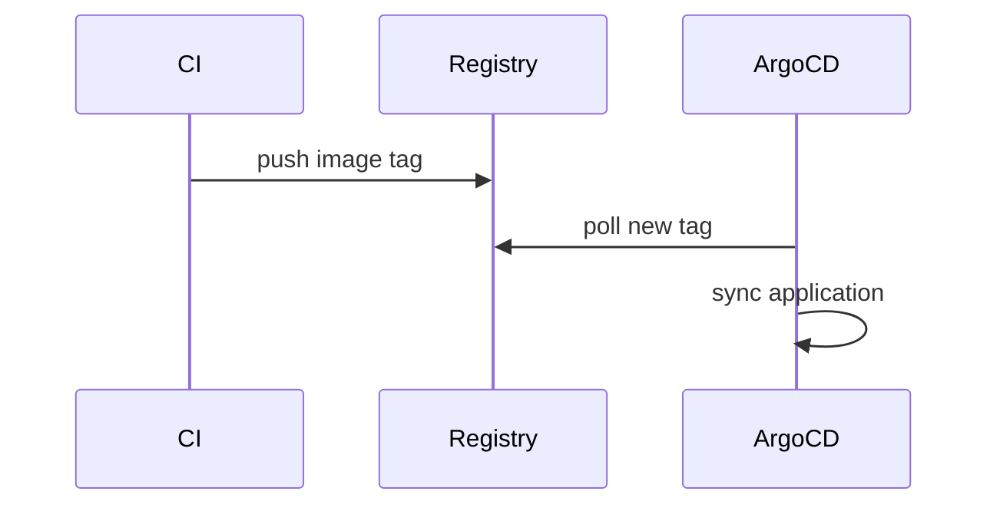

# Visuals

Read this at step 2. Pick one visual, two at most: the smallest one that makes the change clear.
Keep only the nodes the reviewer needs. Use the diff-shaped variant when the surrounding structure
already exists and the point is what changes in it. Every block below renders on GitHub and GitLab.

| The change is about | Visual |
|---|---|
| Terraform resources | Plan address tree |
| Kubernetes manifests | `kubectl diff` excerpt or overlay tree |
| Go control flow | Call tree |
| Files moved, added, split | File tree |
| Interactions between services or components | Mermaid sequence or flowchart |
| Logic inside one function | Pseudocode, or the whole new function when most of it is new |

## Plan address tree

Group `terraform plan` addresses by module. Prefix each with its action: `+` create, `~` update in
place, `-/+` replace, `-` destroy. A `-/+` or `-` line makes the change a one-way door candidate.

```text
module.network
  ~ google_compute_subnetwork.main            # secondary range added
module.gke
  -/+ google_container_node_pool.default      # machine type forces replacement
  + google_container_node_pool.spot
```

## Kubernetes

A trimmed `kubectl diff` (or `kustomize build <overlay> | kubectl diff -f -`):

```diff
 spec:
   template:
     spec:
       containers:
         - name: api
-          image: registry.example.com/api:1.4.2
+          image: registry.example.com/api:1.5.0
           resources:
+            limits:
+              memory: 512Mi
```

An overlay tree, when the change is in which environment gets what:

```text
deploy/
├── base/                 # Deployment, Service
└── overlays/
    ├── staging/          # replicas: 1
    └── production/       # replicas: 3, + PodDisruptionBudget
```

## Call tree

```diff
 Handler.ServeHTTP
   auth.Verify
+  ratelimit.Allow          # rejects with 429 before the store call
   store.Get
-    cache.Get
+    cache.GetOrLoad        # single flight on miss
```

## File tree

```diff
 internal/
 ├── config/
-│   └── config.go
+│   ├── load.go           # reads files and env
+│   └── validate.go       # rejects unknown keys
 └── server/
```

## Mermaid

````markdown

````

Use `flowchart LR` for data flow or a decision path.

## Pseudocode

```diff
 on reconcile(app)
-  apply manifests
+  if spec unchanged since last sync
+    return
+  apply manifests
+  record sync hash
```

When most of a function is new, show the whole TypeScript or Go function instead of a diff.
