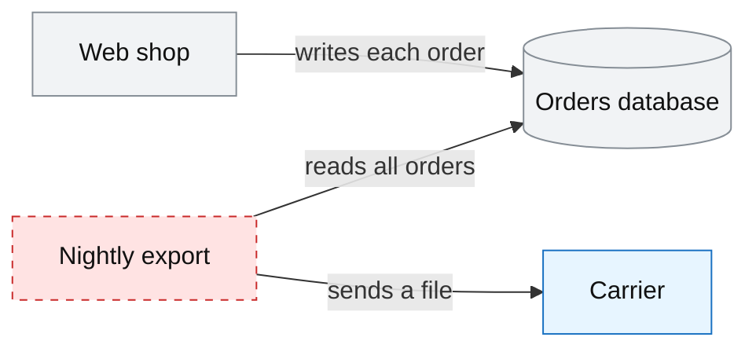
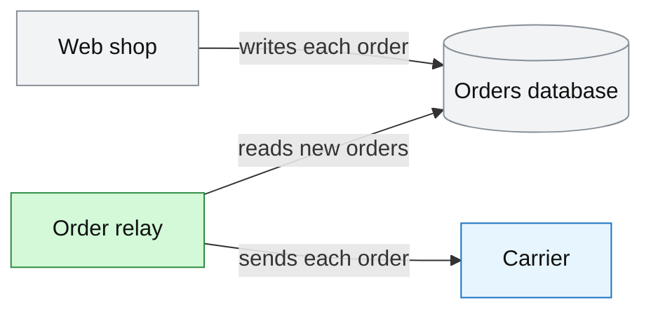

# Visuals

A visual replaces text. Add one only when it answers one question that a sentence of 25 words or
fewer does not, then delete the text it replaces.

## Steps

1. **Pick.** Find the content in the table and take its visual. Done when you can write the one
   question the visual answers.
2. **Draw.** Apply the colors, the legend and the limits below. Done when the source is written.
3. **Caption.** Under the visual, write one paragraph that states the takeaway (what the reader
   concludes, not what the picture shows), then the legend line. Done when both are there.
4. **Render and look.** Follow [Render and look](#render-and-look). Done when every visual was
   opened as an image, or is reported as not rendered.

## Visual by content

| The content is | Visual |
|---|---|
| Boundaries and parts | Mermaid flowchart, one C4 level per chart (context, container or component), each boundary a subgraph |
| A cloud deployment | Mermaid `architecture-beta` up to 8 nodes; else D2 |
| A change | Two flowcharts, before then after, same nodes in the same order and direction |
| Interactions | Mermaid sequence, 8 messages max |
| A lifecycle or stages | Mermaid state diagram |
| Dates | Mermaid Gantt |
| Options | Table: one row per decision driver, one column per option |
| Risks | Table sorted by severity, worst first |
| Measurements | Mermaid `xychart-beta` up to 8 bars; else a table |
| Volumes from A to B | Table |
| A data model | Mermaid ER diagram |

Use Mermaid, D2, SVG or Excalidraw, whichever shows the content best; on a tie, Mermaid.
Replace a Mermaid `C4*`, `timeline` or `quadrantChart` chart by the visual of its row.

## Limits

Per diagram: 10 nodes, 12 edges, 6 words per label. Per RFC: 6 diagrams; per ADR: 1. Over a limit,
split by question or raise the level of detail.

## Colors and legend

Give each node that has a state one class. Write one legend line that names only the colors used.

| Class | Means | Fill | Stroke |
|---|---|---|---|
| `new` | added by the change | `#d3f9d8` | `#2b8a3e` |
| `changed` | kept and modified | `#fff3bf` | `#e67700` |
| `removed` | deleted by the change | `#ffe3e3` | `#c92a2a`, dashed |
| `unchanged` | kept as it is | `#f1f3f5` | `#868e96` |
| `external` | outside the document's scope | `#e7f5ff` | `#1971c2` |

Mermaid, copy the lines used:

```text
classDef new fill:#d3f9d8,stroke:#2b8a3e,color:#111
classDef changed fill:#fff3bf,stroke:#e67700,color:#111
classDef removed fill:#ffe3e3,stroke:#c92a2a,color:#111,stroke-dasharray:5 5
classDef unchanged fill:#f1f3f5,stroke:#868e96,color:#111
classDef external fill:#e7f5ff,stroke:#1971c2,color:#111
```

## Sample: a change

Before:



The carrier learns about an order only after the nightly export.

Legend: dashed red is removed, gray is unchanged, blue is external.

After:



The carrier learns about an order in seconds, and no nightly job is left to fail.

Legend: green is new, gray is unchanged, blue is external.

## Sample: D2

```d2
direction: right
classes: {
  new: {style: {fill: "#d3f9d8"; stroke: "#2b8a3e"; font-color: "#111"}}
  changed: {style: {fill: "#fff3bf"; stroke: "#e67700"; font-color: "#111"}}
  removed: {style: {fill: "#ffe3e3"; stroke: "#c92a2a"; font-color: "#111"; stroke-dash: 5}}
  unchanged: {style: {fill: "#f1f3f5"; stroke: "#868e96"; font-color: "#111"}}
  external: {style: {fill: "#e7f5ff"; stroke: "#1971c2"; font-color: "#111"}}
}
shop: Web shop {class: unchanged}
queue: Order queue {class: new}
relay: Order relay {class: new}
carrier: Carrier {class: external}
shop -> queue: adds each order
queue -> relay: delivers
relay -> carrier: sends
```

The queue keeps orders while the carrier is down, so the shop never waits.

Legend: green is new, gray is unchanged, blue is external.

## Source and SVG

A visual that is not Mermaid commits two files side by side, the source and the exported SVG
(`orders.d2` and `orders.svg`), and the doc shows the SVG as an image. The SVG must be readable on a
light and on a dark page: give it an opaque background.

## Render and look

Work in a temporary folder.

1. Render every Mermaid block of the doc: `mmdc -i <doc> -o <dir>/out.md -e png -b white -s 2`, then
   again with `-t dark -b '#0d1117'`. When Chrome is missing, pass `-p <json>` with
   `{"executablePath": "<path of an installed Chrome or Chromium>"}`.
2. Render each D2 source: `d2 --pad 20 <name>.d2 <name>.svg`, then open the SVG in a browser.
3. Open each image. Fix and render again until: every label is whole and readable, no edge crosses
   a node, before and after line up, the colors match the legend, and the caption's takeaway is
   visible in the picture.

When a renderer is missing, or fails for a reason other than the source, do not install it: put
`Not rendered: <visual>, <reason>` in the reply, one line per visual.
